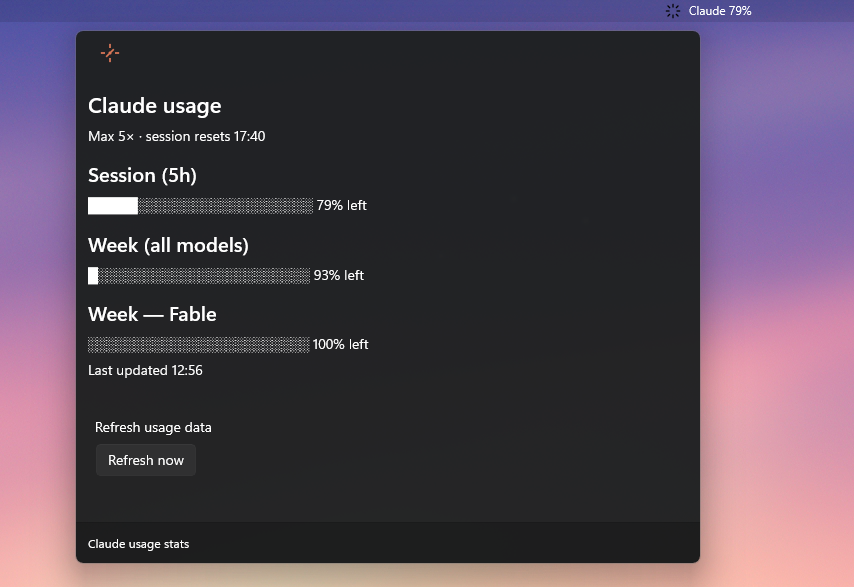

# ClaudeUsage

**See how much Claude Code you have left — right in your Windows dock.**

A PowerToys Command Palette extension that pins your Claude Code subscription limits to the CmdPal dock as a live percentage band. Click it for the full picture:

## Features

- **⚡ Dock band**: live indicator of your 5-hour session and weekly limit (% left, side by side); hover either value for its reset time
- **📊 Stats page**: session, weekly, and per-model limits as progress bars, with reset times and a one-click refresh
- **🎨 Smart color alerts**: icons follow your light/dark theme and switch to the brand color when less than 20% of a limit remains
- **🔒 Zero telemetry**: talks only to Anthropic's official usage endpoint with the token Claude Code already stores locally; nothing else leaves your machine

## Requirements

- Windows 11 (22H2 or later)
- PowerToys Command Palette (v0.9+)
- Claude Code signed in with a valid OAuth token

## Installation

The easiest way to install ClaudeUsage is using our pre-built releases:

1. Download the latest `ClaudeUsage-Release.zip` from the [Releases](../../releases) page.
2. Extract the ZIP file to a folder.
3. Right-click `install.ps1` and select **Run with PowerShell**.
4. Allow the UAC prompt. This will safely install the package and its certificate.
5. Open Command Palette (Win+Alt+Space).
6. Enable "Claude usage" in Dock settings to see the live band.

### Building from source

If you want to build it yourself:

1. Clone/download this repo
2. Run `build-and-install.ps1` from a normal PowerShell prompt
3. On first install, UAC prompts once to trust the dev certificate; updates install without elevation
4. Open Command Palette (Win+Alt+Space)
5. Enable "Claude usage" in Dock settings to see the live band

If you get a "script disabled" error running either script: `Set-ExecutionPolicy -ExecutionPolicy RemoteSigned -Scope CurrentUser`

## How it Works

ClaudeUsage reads your Claude Code OAuth token from `%USERPROFILE%\.claude\.credentials.json` and fetches live usage data from `https://api.anthropic.com/api/oauth/usage` at most every 3 minutes. The dock band redraws every 30 seconds from that cache; after a failed request it waits with exponential backoff (1 to 30 minutes, or longer if the API asks for it).

No token is logged or displayed. The endpoint is internal/undocumented (the same one Claude Code's own UI uses to show its rate limits), so it can change without notice.

## Troubleshooting

The dock band reports its state instead of numbers when something is wrong:

| Band subtitle | Meaning |
|---|---|
| `sign in to Claude Code` | `%USERPROFILE%\.claude\.credentials.json` not found — sign in to Claude Code |
| `open Claude Code to refresh login` | The stored login token has expired; Claude Code renews it the next time it runs |
| `rate limited · retry {time}` | The API asked to slow down; the next request is sent at the shown time |
| `API error {status}` | The usage endpoint returned an error |
| `offline` | Network unreachable or request timed out |
| `parse error` | Response could not be parsed |
| `stale {time} · …` | The last request failed; the band keeps showing the values fetched at `{time}` |

For a full trace, create an empty file `%TEMP%\claudeusage-debug.on` and check `%TEMP%\claudeusage-debug.log` — it records the request/response flow but never the token. Delete the flag file to stop logging.

## Development

- Edit source files in `ClaudeUsage/` (C# 12, .NET 9.0-windows)
- Bump the version in `Package.appxmanifest`, then run `build-and-install.ps1`
- Check PowerShell output for build errors

## License

MIT — see [LICENSE](LICENSE).
